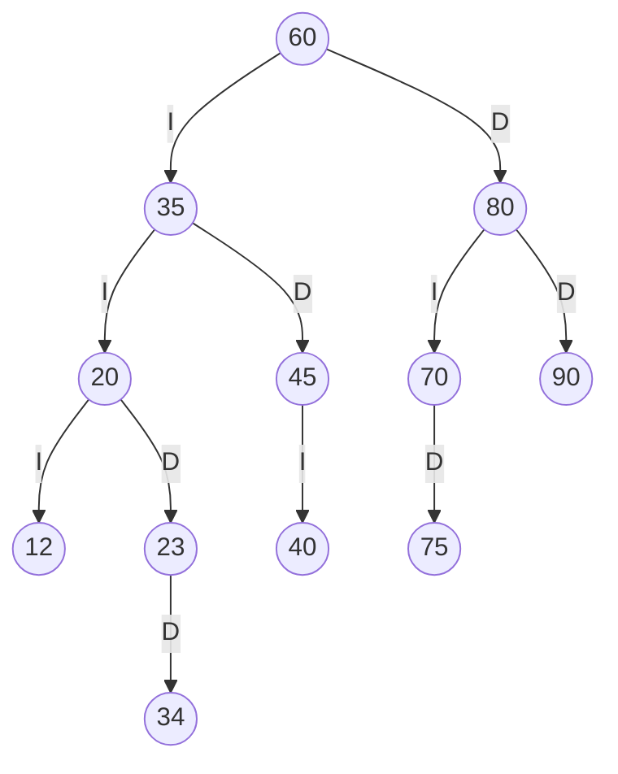
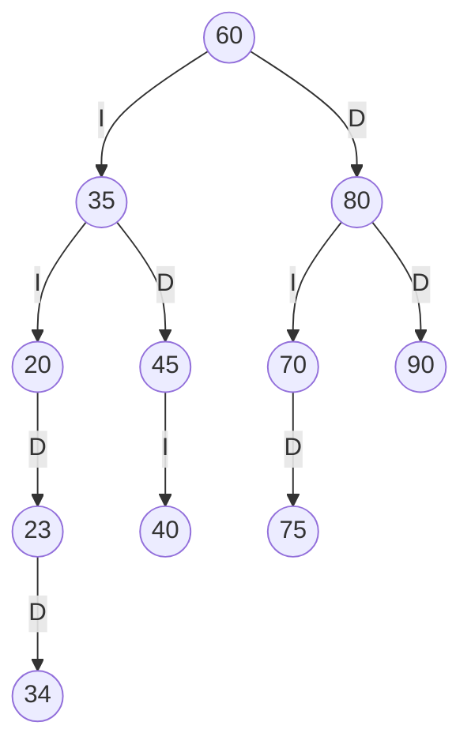
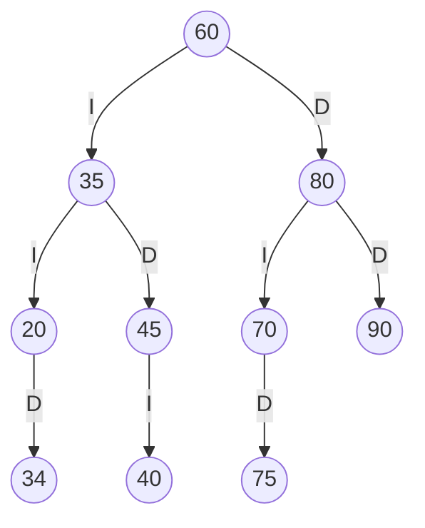
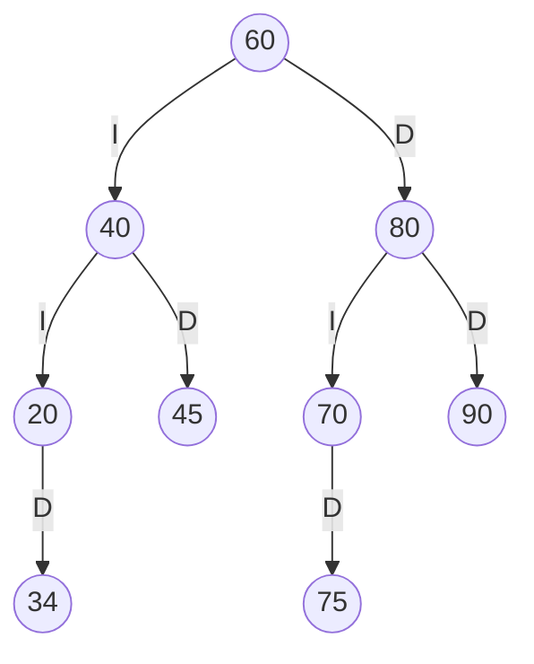

# TRAZAS — Resolución a mano y comparación con el programa

> **IMPORTANTE (antes de entregar):** este documento está resuelto con la cédula de ejemplo terminada en
> **1234**. Debe rehacerlo con **los 4 últimos dígitos de SU cédula** y escribir a mano el procedimiento.
> Los pasos y el formato son los mismos; solo cambian los tres códigos y, por tanto, el árbol resultante.

## 1. Códigos personales

Cédula (4 últimos dígitos): **a b c d = 1 2 3 4**

| Código | Cálculo | Valor | ¿Es 0, repetido o ya existe? | Valor final |
|--------|---------|-------|------------------------------|-------------|
| ab     | 1 y 2   | 12    | No                           | **12**      |
| bc     | 2 y 3   | 23    | No                           | **23**      |
| cd     | 3 y 4   | 34    | No                           | **34**      |

Códigos que ya existen en SW-E1: 60, 35, 80, 20, 45, 70, 90, 40, 75.

## 2. Inserción

Secuencia de SW-E1: `60, 35, 80, 20, 45, 70, 90, 40, 75` y luego `12, 23, 34`.

| Paso | Código | Recorrido de comparaciones                         | Resultado                       |
|------|--------|-----------------------------------------------------|---------------------------------|
| 1    | 60     | árbol vacío                                         | raíz                            |
| 2    | 35     | 35 < 60                                             | izquierdo de 60                 |
| 3    | 80     | 80 > 60                                             | derecho de 60                   |
| 4    | 20     | 20 < 60, 20 < 35                                    | izquierdo de 35                 |
| 5    | 45     | 45 < 60, 45 > 35                                    | derecho de 35                   |
| 6    | 70     | 70 > 60, 70 < 80                                    | izquierdo de 80                 |
| 7    | 90     | 90 > 60, 90 > 80                                    | derecho de 80                   |
| 8    | 40     | 40 < 60, 40 > 35, 40 < 45                           | izquierdo de 45                 |
| 9    | 75     | 75 > 60, 75 < 80, 75 > 70                           | derecho de 70                   |
| 10   | 12     | 12 < 60, 12 < 35, 12 < 20                           | izquierdo de 20                 |
| 11   | 23     | 23 < 60, 23 < 35, 23 > 20                           | derecho de 20                   |
| 12   | 34     | 34 < 60, 34 < 35, 34 > 20, 34 > 23                  | derecho de 23                   |

## 3. ABB final (aristas I = izquierdo, D = derecho)



## 4. Recorridos

| Recorrido | Regla                    | Resultado                              |
|-----------|--------------------------|----------------------------------------|
| Preorden  | raíz → izquierda → derecha | 60 35 20 12 23 34 45 40 80 70 75 90  |
| Inorden   | izquierda → raíz → derecha | 12 20 23 34 35 40 45 60 70 75 80 90  |
| Posorden  | izquierda → derecha → raíz | 12 34 23 20 40 45 35 75 70 90 80 60  |

Comprobación: el inorden sale ordenado de menor a mayor, como debe ocurrir en todo ABB.

### Traza del preorden

```
entra 60
VISITA 60
  entra 35
  VISITA 35
    entra 20
    VISITA 20
      entra 12
      VISITA 12
        null -> regresa
        null -> regresa
      entra 23
      VISITA 23
        null -> regresa
        entra 34
        VISITA 34
          null -> regresa
          null -> regresa
    entra 45
    VISITA 45
      entra 40
      VISITA 40
        null -> regresa
        null -> regresa
      null -> regresa
  entra 80
  VISITA 80
    entra 70
    VISITA 70
      null -> regresa
      entra 75
      VISITA 75
        null -> regresa
        null -> regresa
    entra 90
    VISITA 90
      null -> regresa
      null -> regresa
Secuencia PREORDEN: 60 35 20 12 23 34 45 40 80 70 75 90
```

## 5. Eliminaciones (sobre el árbol del punto 3, en este orden)

### 5.1 Hoja: eliminar 12
12 no tiene hijos: se quita y `20.izquierdo = null`.



### 5.2 Un hijo: eliminar 23
23 solo tiene hijo derecho (34): el hijo ocupa su lugar, `20.derecho = 34`.



### 5.3 Dos hijos: eliminar 35
35 tiene hijos 20 y 45. Sucesor inorden = mínimo del subárbol derecho: bajar por 45 → izquierda 40 (sin hijo izquierdo) ⇒ **40**.
Se copia 40 en el nodo de 35 y se elimina la hoja 40 del subárbol derecho (`45.izquierdo = null`).



Preorden final: `60 40 20 34 45 80 70 75 90`.

## 6. Salida del programa vs. resolución a mano

| Punto                        | Resultado a mano                          | Salida del programa                       | ¿Coincide? |
|------------------------------|-------------------------------------------|--------------------------------------------|------------|
| Preorden (tras insertar)     | 60 35 20 12 23 34 45 40 80 70 75 90       | 60 35 20 12 23 34 45 40 80 70 75 90        | ✅ Sí |
| Inorden                      | 12 20 23 34 35 40 45 60 70 75 80 90       | 12 20 23 34 35 40 45 60 70 75 80 90        | ✅ Sí |
| Posorden                     | 12 34 23 20 40 45 35 75 70 90 80 60       | 12 34 23 20 40 45 35 75 70 90 80 60        | ✅ Sí |
| Traza del preorden           | Sección 4                                 | Idéntica (opción 10 del menú)              | ✅ Sí |
| Tras eliminar 12 (hoja)      | 60 35 20 23 34 45 40 80 70 75 90          | 60 35 20 23 34 45 40 80 70 75 90           | ✅ Sí |
| Tras eliminar 23 (un hijo)   | 60 35 20 34 45 40 80 70 75 90             | 60 35 20 34 45 40 80 70 75 90              | ✅ Sí |
| Tras eliminar 35 (dos hijos) | 60 40 20 34 45 80 70 75 90                | 60 40 20 34 45 80 70 75 90                 | ✅ Sí |

> Si alguna fila no coincidiera en su caso, anótelo aquí y explique la causa (error a mano o en el código).
